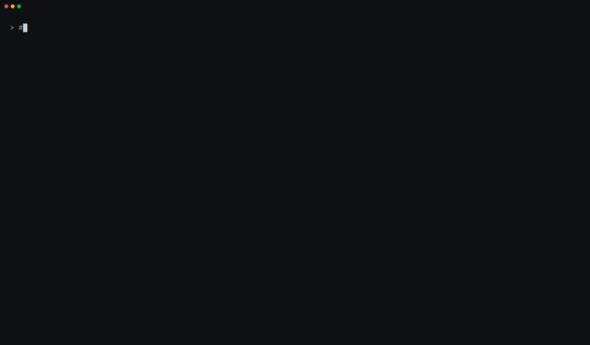
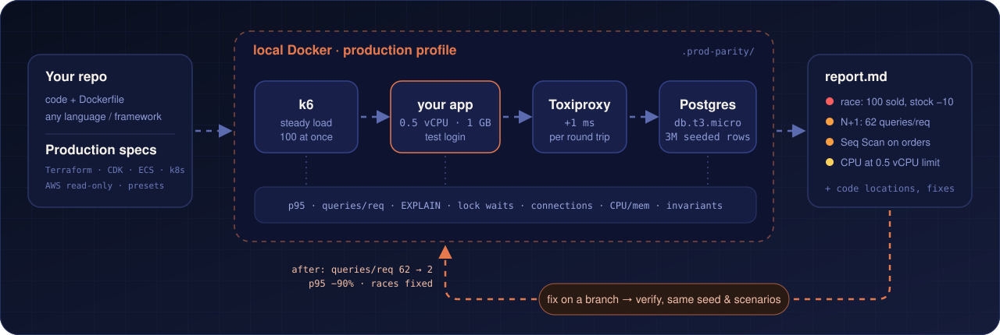

<p align="center">
  
</p>

<p align="center">
  <b>本番スペックのままローカル Docker で負荷テストし、本番でしか表に出ない N+1、レース、インデックス漏れを<br>
  コーディングエージェントが見つけ、説明し、修正します。</b>
</p>

<p align="center">
  <a href="README.md">English</a> · <a href="README.ko.md">한국어</a> · <b>日本語</b> · <a href="README.zh-CN.md">简体中文</a>
</p>

<p align="center">
  <a href="https://github.com/kmsdevdata-sketch/catchme/actions/workflows/e2e.yml"></a>
  
  
  
</p>

---

**catchme がない場合:** ノート PC 上ではテストが通ります。データは 50 行、CPU 制限なし、ネットワーク遅延なし。ところが本番では
`GET /orders` が 1 リクエストあたり 80 回のクエリを発行し、100 件の同時注文で在庫がずれ、リリースするまで誰も気づきません。

**catchme がある場合:** *「本番スペックでテストして」* と頼むだけです。エージェントがローカル Docker 上に 0.5 vCPU、`db.t3.micro`、
DB ラウンドトリップごとに +1 ms、100 万行のデータを再現し、API に実際の負荷とレースをかけ、
証拠、原因となるコード、別ブランチでの修正、そして修正前後の比較表を持ち帰ります。

<p align="center">
  
</p>

## クイックスタート

**前提条件:** Docker（Compose v2）が起動していること、Claude Code、Dockerfile でビルドでき PostgreSQL を使うアプリ。

**1. インストール** — Claude Code で:

```bash
/plugin marketplace add kmsdevdata-sketch/catchme
/plugin install catchme@catchme
```

**2. プロジェクトを開いて Claude にこう伝えます:**

```text
本番スペックでテストして
```

```text
注文一覧 API を ECS 0.5 vCPU / 1 GB、RDS t3.micro、注文 100 万件でテストして、
100 件の同時注文で在庫数が壊れないか確認して。
```

```text
このスペックで同時接続ユーザーは何人まで耐えられる？ t3.micro と t3.small で比較して。
```

**3. 質問に 1 つ答え**（リポジトリに Terraform / CDK / ECS / k8s のファイルがない場合、どの本番スペックにするか）、
小さなアプリなら 10〜15 分ほど待ってから（大きなプロジェクトではシナリオ設計に時間がかかるため、さらに長くなります） `.prod-parity/reports/latest.md` を読みます。見つかった問題をブランチで修正して再計測するか
エージェントに聞かれたら、*はい* と答えてください。

初めての方は **[ステップバイステップガイド](docs/getting-started.ja.md)** で、各ステップ、聞かれる内容、
レポートの読み方、トラブルシューティング、FAQ を確認できます。

アンインストールするには、テストした各プロジェクトで `teardown` を実行し（Claude に片付けを頼んでも構いません）、
`.prod-parity/` を削除してから、`/plugin uninstall catchme@catchme` と `/plugin marketplace remove catchme` を実行します。

## 検出できる問題

| | 問題 | catchme の検出方法 | レポートに載る証拠の例 |
|---|---|---|---|
| 🔀 | **レース** — 更新の消失、売り越し | 100 件の同時書き込み後に SQL の不変条件を検証 | `100 sold, stock 100000 → 99998` |
| 🔁 | **N+1 クエリ** | 1 ms の遅延下で `pg_stat_statements` からリクエストあたりのクエリ数を算出 | `62.9 queries/request; one statement runs 41.9× per request` |
| 🐢 | **インデックス漏れ** | 数百万行のデータで最も重いステートメントを `EXPLAIN` | `Seq Scan on orders (1M rows), Filter user_id = $1` |
| 🚰 | **プール枯渇、コネクションの使い捨て** | 0.25 秒ごとの接続数をプールサイズと比較、リクエストあたりの新規セッション数 | `1.00 new sessions per request` |
| 🔒 | **ロック競合** | PostgreSQL ログから 100 ms 以上のロック待ちとデッドロックを検出 | `18 lock waits of 100 ms or longer` |
| 📉 | **キャパシティ** | p95 / エラー率の目標値に対して限界点を探索 | `This spec holds up to 13 concurrent requests` |

レポートの全体例：[Prisma デモ（修正前）](resources/prisma/report-prod.en.md) ·
[修正後（修正前後の比較表つき）](resources/prisma/report-after-fix.en.md)（英語）。

## 実際のアプリで見つかったもの

デモのバグは意図的に仕込んだものです。以下は開発中の Spring Boot マーケットプレイスアプリを、ECS タスクと同じサイズ
（0.5 vCPU / 1 GB、JVM のデフォルトヒープ）と `db.t3.micro` 相当の Postgres で動かした結果です。

- **決済の副作用の重複とコネクションプールのデッドロック。** 同じ決済を同時に 30 回確定すると、注文は 1 件なのに
  ステータス履歴が 10 件、通知が 20 件作られ、すべてのリクエストが 30 秒のタイムアウトまで止まりました。`open-in-view`
  のせいでロック付きの再確認でも古いエンティティを読み、`AFTER_COMMIT` リスナーが各リクエストで 1 本目を握ったまま
  2 本目のコネクションを要求したため、10 本の Hikari プールがデッドロックしました。統合テストはサービスを直接呼び出し、
  OSIV フィルターを通らないため、どちらも検出できていませんでした。
- **1 リクエストあたり 5,014 クエリのダッシュボード**（p95 13 秒）：未読メッセージを問い合わせごとに数えていました。
  バッチ版のメソッドはすでにあったにもかかわらず。
- **データが増えると壊れるクエリ：** バッチ版は問い合わせ 1 件につき 2 つのパラメータをバインドするため、ストアあたり
  約 1 万 6 千件で PostgreSQL JDBC のバインドパラメータ上限 32,767 を超えます。ページネーションのない一覧は最大 3.6 MB でした。

## 仕組み

<p align="center">
  
</p>

1. **分析** — プロジェクトのスタック、ポート、エンドポイント、ログイン、Dockerfile を調べます。
2. **プロファイル** — Terraform / CDK / ECS / k8s、読み取り専用の AWS 参照、またはプリセットから本番構成を特定します。
3. **構築** — Docker 上に CPU とメモリの制限、RDS 相当の Postgres、Toxiproxy による遅延、さらにアプリに必要な Redis / キュー / モックを用意します。
4. **シード** — マイグレーション済みのスキーマに、整合性のとれた数百万行のデータとテストユーザーを投入します。
5. **負荷** — 実際のログイン API を通して k6 で負荷をかけます。ウォームアップ、定常負荷、ランプ、100 件同時のレース。
6. **レポート** — 証拠、コードの位置、修正案とともに結果をまとめます。数値からは分からないことも明記します。
7. **修正と検証** — git worktree のブランチ上で、同じプロファイル、データ、シナリオを使って修正と検証を行います。

環境と数値の再現性はスクリプトが担保し、判断はエージェントが行います。

## k6 だけではダメなの？

catchme は k6 を使っています。Toxiproxy、`pg_stat_statements`、Docker のリソース制限も同様です。catchme が加えるのは、それらの周りすべてです。

| | 負荷ツール（k6、Gatling、JMeter） | APM（Datadog、New Relic） | 統合テスト | catchme |
|---|---|---|---|---|
| 本番相当の CPU、DB クラス、レイテンシ、データ量 | 自分で構築 | 本番そのもの | ほぼない | IaC / スペックから構築 |
| シナリオとテストデータの作成 | 自分で | — | 自分で | エージェントがコードから |
| *なぜ* 遅いかの説明（リクエストあたりのクエリ数、EXPLAIN、ロック、プール） | レイテンシのみ | リリース後に | — | リリース前に |
| レースが起きたかの判定 | ステータスコード | — | シングルスレッド | データに対する SQL 不変条件 |
| HTTP スタック全体を通る（フィルター、OSIV、リスナー） | はい | はい | 多くは通らない | はい |
| 修正と再計測 | — | — | — | ブランチ上で、同じデータで |

## 対応環境

Dockerfile でビルドでき、HTTP で通信し、PostgreSQL を使うものであれば、言語やフレームワークは問いません。以下の構成でエンドツーエンドに検証済みです:

| スタック | クエリ数/リクエスト | 注文一覧 p95 | レース |
|---|---:|---:|---|
| [Node.js + Prisma](examples/demo-shop-prisma) | 61 → 3 | 1,677 → 110 ms | ❌ → ✅ |
| [NestJS + TypeORM](examples/demo-shop-nest-typeorm) | 63 → 2 | 1,232 → 111 ms | ❌ → ✅ |
| [Spring Boot + JPA](examples/demo-shop-spring) | 62 → 2 | 1,175 → 512 ms | ❌ → ✅ |
| [Django](examples/demo-shop-django) | 64 → 3 | 2,728 → 309 ms | ❌ → ✅ |
| [FastAPI + SQLAlchemy](examples/demo-shop-fastapi) | 62 → 2 | 2,050 → 497 ms | ❌ → ✅ |
| [Go net/http + pgx + Redis](examples/demo-shop-go) | 81 → 2 | 1,966 → 47 ms | ❌ → ✅ |

エージェントによる修正の前 → 後。ECS Fargate 0.5 vCPU / 1 GB、RDS `db.t3.micro`、アプリ↔DB 間 1 ms、注文 100 万件。
Go のデモには検出器もリファレンスもなく、エージェントがスキルだけを頼りにセットアップしました。詳細: [resources/](resources/README.md)。

## 安全性

- **ローカル Docker のみ。** `.env`、アプリ設定、負荷テストの対象がローカル以外のホストを指している場合は実行を拒否します。
- **AWS は読み取り専用**、かつ同意を得た場合のみ使用します。認証情報が出力されることはありません。
- **テスト用アカウントとテスト用シークレットのみ** を使用します。
- **作業中のブランチには一切触れません** — 修正は git worktree の新しいブランチに入ります。

**コストとデータ。** catchme は無料で、テレメトリはありません。手元の Claude Code の中で動くため、1 回のテストは他の
長めのタスクと同じように Claude プランの利用枠を使います（エージェントがコードを読み、テストファイルを書きます）。
catchme 自身が発生させる通信は、Docker イメージの取得（Postgres、Toxiproxy、k6、アプリのビルド）と、依頼した場合のみの
読み取り専用 AWS `describe` 呼び出しだけです。コードは他の Claude Code のリクエストと同じ方法で Claude に送られます。

## 制限事項

結果はあくまで **本番の近似** であり、再現ではありません。CPU の世代、ディスク IOPS、バーストクレジットの枯渇、
AZ 間のばらつき、実データの分布はモデル化されておらず、すべてのレポートにその旨が記載されます。実行ごとのばらつきも想定してください
（限界点で ±3 程度。0.5 vCPU の JVM ではさらに大きくなります）。現時点では PostgreSQL のみ対応しており、MySQL は対応予定です。

## ドキュメント

- [はじめに](docs/getting-started.ja.md) — インストール、初回実行、レポートの読み方、修正と検証、トラブルシューティング、FAQ
- [スキル](skills/catchme/SKILL.md) — エージェントが読むもの · [スタック別リファレンス](skills/catchme/references/) · 他のエージェント向けの [AGENTS.md](AGENTS.md)
- [デモ](examples/) と [記録済みの結果](resources/README.md)

## ロードマップ

- MySQL 対応
- プルリクエストでのリグレッションレポート（オプトインの GitHub Actions、結果は job summary に表示）
- GCP・Azure のインスタンスプリセット
- EBS / RDS ストレージを近似するディスク I/O 制限
- 実際のアクセスログのリプレイによる負荷
- p95 目標を満たす最小スペックの探索

## コントリビューション

Issue や PR を歓迎します。特にスタック別リファレンス（Rails、Laravel、.NET、Rust など）と MySQL 対応は大歓迎です。
[CONTRIBUTING.md](CONTRIBUTING.md) をご覧ください。

## ライセンス

[MIT](LICENSE)
