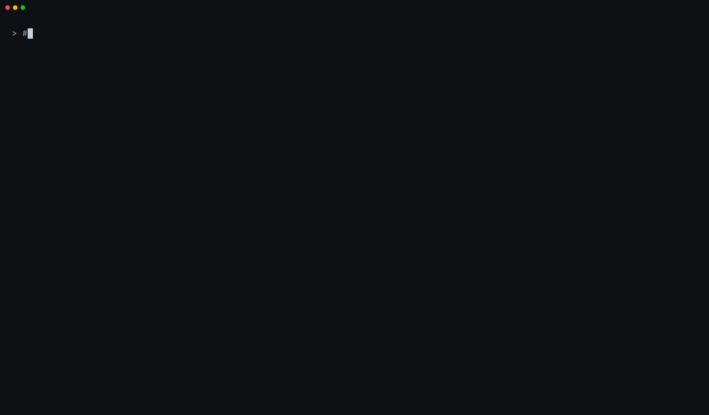
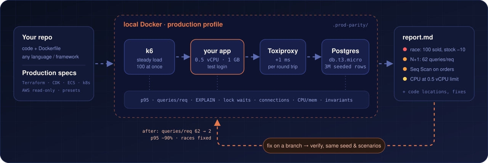

<p align="center">
  
</p>

<p align="center">
  <b>로컬 Docker에서 운영 사양으로 앱을 부하 테스트하고, 운영에서야 드러나는<br>
  N+1·레이스·인덱스 누락을 코딩 에이전트가 찾아서 설명하고 고칩니다.</b>
</p>

<p align="center">
  <a href="README.md">English</a> · <b>한국어</b> · <a href="README.ja.md">日本語</a> · <a href="README.zh-CN.md">简体中文</a>
</p>

<p align="center">
  <a href="https://github.com/kmsdevdata-sketch/catchme/actions/workflows/e2e.yml"></a>
  
  
  
</p>

---

**catchme가 없으면:** 노트북에서는 테스트가 통과합니다. 데이터 50건, CPU 제한 없음, 네트워크 지연 없음. 운영에서는
`GET /orders`가 요청마다 쿼리를 80개 날리고, 동시 주문 100건에 재고가 사라지는데, 배포하기 전까지 아무도 모릅니다.

**catchme가 있으면:** *"운영 사양으로 테스트해줘"* 한 마디면 됩니다. 에이전트가 0.5 vCPU, `db.t3.micro`, DB 왕복마다
+1ms, 데이터 100만 건을 로컬 Docker에 그대로 만들고 API에 실제 부하와 동시 요청을 넣습니다. 그리고 근거, 원인 코드,
별도 브랜치의 수정안, 수정 전후 비교표까지 가져옵니다.

<p align="center">
  
</p>

## 빠른 시작

**필요한 것:** 실행 중인 Docker(Compose v2), Claude Code, Dockerfile로 빌드되고 PostgreSQL을 쓰는 앱.

**1. 설치** (Claude Code에서):

```bash
/plugin marketplace add kmsdevdata-sketch/catchme
/plugin install catchme@catchme
```

**2. 프로젝트를 열고 Claude에게 이렇게 말하세요:**

```text
운영 사양으로 테스트해줘
```

```text
ECS 0.5 vCPU / 1GB, RDS t3.micro, 주문 100만 건 기준으로 주문 목록 API를 테스트해줘.
동시 주문 100건에 재고가 틀어지는지도 봐줘.
```

```text
이 사양이면 동시 사용자 몇 명까지 버텨? t3.micro랑 t3.small도 비교해줘.
```

**3. 질문 하나에 답하세요.** 레포에 Terraform / CDK / ECS / k8s 파일이 없으면 운영 사양을 물어봅니다.
작은 앱은 10~15분, 큰 프로젝트는 시나리오 설계에 시간이 더 들어 그보다 오래 걸립니다. 끝나면 `.prod-parity/reports/latest.md`를 읽으면 됩니다. 에이전트가 찾은 문제를 브랜치에서 고치고
다시 재보겠냐고 물으면 *응*이라고 답하세요.

처음이라면 **[단계별 가이드](docs/getting-started.ko.md)**를 보세요. 단계마다 무엇을 물어보는지, 리포트는 어떻게
읽는지, 문제가 생겼을 때 어떻게 하는지, 자주 묻는 질문까지 정리돼 있습니다.

## 무엇을 잡아내나요

| | 문제 | catchme가 보는 방법 | 리포트에 실제로 나온 근거 |
|---|---|---|---|
| 🔀 | **레이스**: 갱신 유실, 초과 판매 | 동시 쓰기 100건을 넣고 SQL 불변 조건으로 판정 | `100 sold, stock 100000 → 99998` |
| 🔁 | **N+1 쿼리** | 1ms 지연 아래에서 `pg_stat_statements`로 요청당 쿼리 수 측정 | `62.9 queries/request; one statement runs 41.9× per request` |
| 🐢 | **인덱스 누락** | 수백만 행 위에서 무거운 쿼리를 `EXPLAIN` | `Seq Scan on orders (1M rows), Filter user_id = $1` |
| 🚰 | **커넥션 풀 고갈, 요청마다 새 연결** | 0.25초 간격으로 풀 크기 대비 커넥션 수, 요청당 새 세션 수 측정 | `1.00 new sessions per request` |
| 🔒 | **락 경합** | PostgreSQL 로그의 100ms 이상 락 대기, 데드락 | `18 lock waits of 100 ms or longer` |
| 📉 | **처리 한계** | 목표 p95·에러율 기준 한계점 탐색 | `This spec holds up to 13 concurrent requests` |

## 어떻게 동작하나요

<p align="center">
  
</p>

1. **분석**: 스택, 포트, 엔드포인트, 로그인 방식, Dockerfile을 파악합니다.
2. **프로필**: Terraform / CDK / ECS / k8s, 읽기 전용 AWS 조회, 또는 프리셋에서 운영 사양을 가져옵니다.
3. **환경 구성**: CPU·메모리 제한, RDS 같은 Postgres 설정, Toxiproxy 지연을 Docker에 만듭니다. 앱에 Redis·큐·외부 API 목업이 필요하면 함께 띄웁니다.
4. **시딩**: 마이그레이션된 스키마에 관계가 맞는 데이터 수백만 건과 테스트 계정을 넣습니다.
5. **부하**: 실제 로그인 API를 거쳐 k6로 예열, 지속 부하, 램프, 동시 요청 100건을 넣습니다.
6. **리포트**: 근거, 코드 위치, 수정 방향과 함께 수치로 알 수 없는 한계까지 정리합니다.
7. **수정과 재측정**: git worktree의 새 브랜치에서 고치고, 같은 프로필·데이터·시나리오로 다시 잽니다.

환경과 수치는 스크립트가 재현 가능하게 만들고, 판단은 에이전트가 합니다.

## 지원 환경

Dockerfile로 빌드되고 HTTP로 통신하는 앱이면 언어·프레임워크와 상관없이 됩니다. DB는 PostgreSQL입니다. 끝까지 검증한 스택:

| 스택 | 요청당 쿼리 | 주문 목록 p95 | 레이스 |
|---|---:|---:|---|
| [Node.js + Prisma](examples/demo-shop-prisma) | 61 → 3 | 1,677 → 110 ms | ❌ → ✅ |
| [NestJS + TypeORM](examples/demo-shop-nest-typeorm) | 63 → 2 | 1,232 → 111 ms | ❌ → ✅ |
| [Spring Boot + JPA](examples/demo-shop-spring) | 62 → 2 | 1,175 → 512 ms | ❌ → ✅ |
| [Django](examples/demo-shop-django) | 64 → 3 | 2,728 → 309 ms | ❌ → ✅ |
| [FastAPI + SQLAlchemy](examples/demo-shop-fastapi) | 62 → 2 | 2,050 → 497 ms | ❌ → ✅ |
| [Go net/http + pgx + Redis](examples/demo-shop-go) | 81 → 2 | 1,966 → 47 ms | ❌ → ✅ |

에이전트가 수정하기 전 → 후 수치입니다. 조건은 ECS Fargate 0.5 vCPU / 1GB, RDS `db.t3.micro`, 앱↔DB 1ms, 주문 100만 건입니다.
Go 데모는 전용 감지 코드도 레퍼런스도 없는 스택이고, 에이전트가 스킬만 보고 구성했습니다. 자세한 결과: [resources/](resources/README.md).

## 안전

- **로컬 Docker 안에서만 동작합니다.** `.env`, 앱 설정, 부하 대상이 로컬이 아닌 호스트를 가리키면 멈춥니다.
- **AWS는 읽기 전용으로만**, 사용자가 동의할 때만 조회하고, 자격증명은 출력하지 않습니다.
- **테스트 계정과 테스트 비밀키만** 씁니다.
- **현재 브랜치는 건드리지 않습니다.** 수정은 git worktree의 새 브랜치에서 합니다.

## 한계

결과는 운영의 **재현이 아니라 근사치**입니다. CPU 세대, 디스크 IOPS, 버스트 크레딧 소진, AZ 간 편차, 실제 데이터
분포는 반영하지 않으며, 리포트마다 이 한계를 적어둡니다. 실행마다 편차가 있습니다(한계점 기준 ±3 정도, 0.5 vCPU의
JVM은 더 큼). 지금은 PostgreSQL만 지원하고, MySQL은 계획 중입니다.

## 문서

- [시작 가이드](docs/getting-started.ko.md): 설치, 첫 실행, 리포트 읽기, 수정과 재측정, 문제 해결, 자주 묻는 질문
- [스킬](skills/catchme/SKILL.md): 에이전트가 읽는 문서 · [스택별 레퍼런스](skills/catchme/references/) · 다른 에이전트용 [AGENTS.md](AGENTS.md)
- [데모](examples/)와 [기록된 결과](resources/README.md)

## 기여

이슈와 PR 환영합니다. 특히 스택 레퍼런스(Rails, Laravel, .NET, Rust 등)와 MySQL 지원을 기다리고 있습니다.
[CONTRIBUTING.md](CONTRIBUTING.md)를 보세요.

## 라이선스

[MIT](LICENSE)
