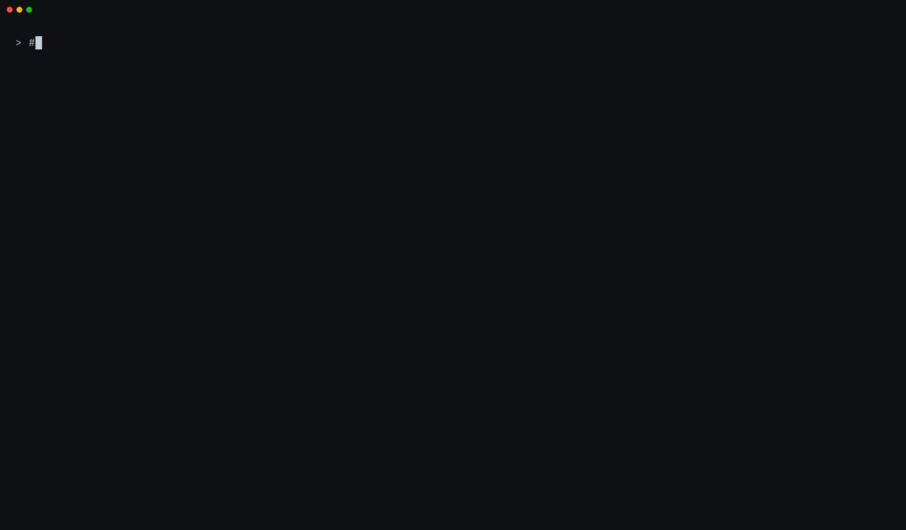
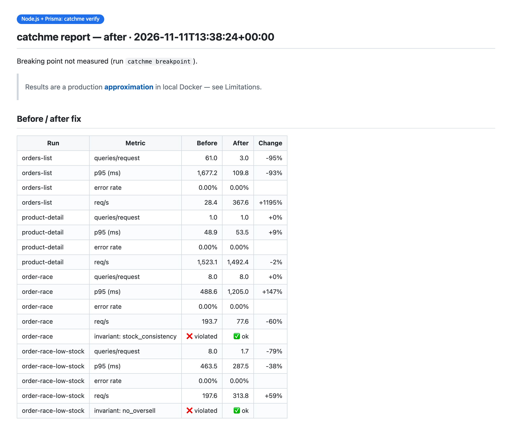

# catchme

**Catch me if you can — before production does.**

Your laptop has 50 rows, no CPU limit and zero network latency. Production has a million rows,
0.5 vCPU, a `db.t3.micro` and 1 ms per round trip. That's why N+1 queries, pool exhaustion,
lock contention, missing indexes and races show up only in production.

catchme is a skill for coding agents (Claude Code plugin + `AGENTS.md`). It approximates your
production specs in local Docker, puts load on your API, and reports what breaks and why — with
evidence — then fixes it on a separate branch and re-measures.



> **You:** 운영 사양으로 테스트해줘 / test this with production specs
>
> **Agent:** No IaC found — which specs? *(Fargate 0.5 vCPU/1 GB + RDS t3.micro)* … 100 orders succeeded
> but stock dropped by 10; a product with stock 10 sold 95; `GET /orders` runs 80 queries per request
> (N+1) and scans 500k rows (no index on `orders.user_id`). Fix them on a branch and re-measure?

## What it does

1. **Analyze** the project — any language or framework that builds with a Dockerfile and talks HTTP, on PostgreSQL
2. **Profile** production from Terraform / CDK / ECS task definitions / k8s manifests, a read-only AWS lookup, or presets
3. **Environment** — app + Postgres with Docker `cpus` / `mem_limit`, RDS-like DB settings, Toxiproxy latency
4. **Seed** millions of FK-consistent rows from your migrated schema, deterministically
5. **Load** with k6 — steady load, ramps, and 100 simultaneous writes; invariants (SQL) decide whether a race happened
6. **Collect** p50/p95/p99, throughput, errors, queries per request, EXPLAIN plans, CPU/memory, connections, lock waits, new DB sessions
7. **Report** bottleneck candidates with evidence and stack-specific fixes, local vs production, limitations
8. **Fix & re-measure** in a git worktree branch with the same profile, seed and scenarios → before/after table

Plus: "this spec holds up to N concurrent requests" (breaking-point search), authenticated APIs through
seeded test accounts and the real login API, and an opt-in hook that flags a queries-per-request regression
after the agent edits a repository/model file.



## Works with

catchme measures from the outside — HTTP load, PostgreSQL statistics and EXPLAIN plans, container
resources — so the app can be written in anything. The agent adds whatever else the app needs (Redis,
queues, mocks of external APIs) through `.prod-parity/compose.override.yml`.

Verified end to end on: **Spring Boot + JPA, Node.js + Prisma, NestJS + TypeORM, Django, FastAPI +
SQLAlchemy, Go (net/http + pgx) + Redis**. Database: **PostgreSQL** (MySQL is planned).

## Install

```bash
/plugin install catchme --marketplace kmsdevdata-sketch/catchme
```

(or `/plugin marketplace add kmsdevdata-sketch/catchme`, then `/plugin install catchme@catchme`)

Then ask **"test this with production specs"** / **"운영 사양으로 테스트해줘"**, or run `/catchme:catchme`.

Requirements: Docker with Compose v2 (macOS, Linux; Windows via WSL). Python 3 and curl are used when
present; without Python the scripts run in a container. Other agents: see [AGENTS.md](AGENTS.md).

## Try a demo

Six demo shops with the same planted bugs (N+1, missing index, lost-update + oversell race), one per
stack: [`prisma`](examples/demo-shop-prisma), [`nest-typeorm`](examples/demo-shop-nest-typeorm),
[`spring`](examples/demo-shop-spring), [`django`](examples/demo-shop-django), [`fastapi`](examples/demo-shop-fastapi),
and [`go`](examples/demo-shop-go) — a stack with no detector or reference (Go net/http + pgx + Redis).
Results for all six: [resources/README.md](resources/README.md).

```bash
cd examples/demo-shop-prisma
CM=../../skills/catchme/scripts/catchme
$CM init
$CM profile --app-preset ecs-fargate:0.5vcpu-1gb --db-preset rds:db.t3.micro
$CM all            # gen → up → seed (1M orders) → load → report, ~5 min
$CM breakpoint && $CM report
$CM teardown
```

## What it never does

- Connect to anything outside local Docker. It stops if `.env`, app settings or the load target point
  at a non-local host.
- Call AWS write APIs. Spec lookup uses `describe-*` / `list-*` only and never outputs credentials.
- Use production accounts or secrets.
- Touch your current branch. Fixes go to a git worktree branch you review.

Everything it generates lives in `.prod-parity/` in your project — readable and editable.

## Limitations

Results are a **production approximation**, not a reproduction: CPU clock/generation, disk IOPS, RDS
burst-credit depletion, cross-AZ variance and real data distributions are not modeled, and every report
says so. Run-to-run noise is real — the breaking point moves by about ±3 concurrent requests between
identical runs — so treat small differences as noise unless they repeat.

## License

MIT
