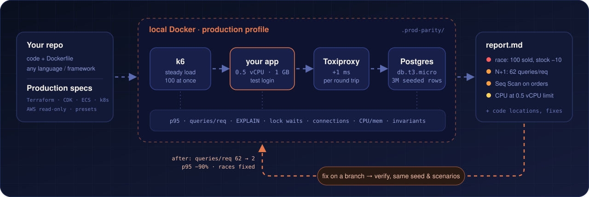

<p align="center">
  
</p>

<p align="center">
  <b>在本地 Docker 中按生产环境规格压测你的应用，让编码 agent 找出、<br>
  解释并修复那些只在生产环境才暴露的 N+1 查询、竞态条件和缺失索引。</b>
</p>

<p align="center">
  <a href="README.md">English</a> · <a href="README.ko.md">한국어</a> · <a href="README.ja.md">日本語</a> · <b>简体中文</b>
</p>

<p align="center">
  <a href="https://github.com/kmsdevdata-sketch/catchme/actions/workflows/e2e.yml"></a>
  
  
  
</p>

---

**没有 catchme：** 测试在你的笔记本上全部通过 —— 50 行数据，没有 CPU 限制，没有网络延迟。到了生产环境，
`GET /orders` 每个请求要跑 80 条查询，100 个并发订单把库存算错了，而上线之前没人发现。

**有了 catchme：** 你只需说一句 *"按生产环境规格测一下"*。agent 会在本地 Docker 中还原 0.5 vCPU、`db.t3.micro`、
每次数据库往返 +1 ms 以及上百万行数据，对你的 API 跑真实的压测和并发竞争，然后带回
证据、问题所在的代码、在独立分支上的修复，以及一张修复前后对比表。

<p align="center">
  
</p>

## 快速开始

**前置条件：** 已启动的 Docker（Compose v2）、Claude Code，以及一个能用 Dockerfile 构建并使用 PostgreSQL 的应用。

**1. 安装** —— 在 Claude Code 中执行：

```bash
/plugin marketplace add kmsdevdata-sketch/catchme
/plugin install catchme@catchme
```

**2. 打开你的项目，对 Claude 说：**

```text
按生产环境规格测一下
```

```text
用 ECS 0.5 vCPU / 1 GB、RDS t3.micro 和 100 万条订单测试订单列表 API，
并检查 100 个并发订单会不会把库存数量搞错。
```

```text
这个规格能扛住多少并发用户？对比一下 t3.micro 和 t3.small。
```

**3. 回答一个问题**（如果仓库里没有 Terraform / CDK / ECS / k8s 文件，会问你要复刻哪种生产规格），
小型应用约需 10–15 分钟（大型项目中 agent 设计场景要花更多时间，会更久），然后查看 `.prod-parity/reports/latest.md`。当 agent 提出在分支上修复
发现的问题并重新测量时，回答 *好的* 即可。

第一次使用？**[分步指南](docs/getting-started.zh-CN.md)** 会带你走完每一步，包括会被问到什么、
如何阅读报告、故障排查和常见问题。

卸载方法：在每个测试过的项目里运行 `teardown`（也可以让 Claude 帮你清理），删除 `.prod-parity/`，
然后运行 `/plugin uninstall catchme@catchme` 和 `/plugin marketplace remove catchme`。

## 能发现什么

| | 问题 | catchme 如何发现 | 报告中的证据示例 |
|---|---|---|---|
| 🔀 | **竞态条件** —— 更新丢失、超卖 | 100 个并发写入，再用 SQL 不变量校验 | `100 sold, stock 100000 → 99998` |
| 🔁 | **N+1 查询** | 在 1 ms 延迟下，基于 `pg_stat_statements` 统计每请求查询数 | `62.9 queries/request; one statement runs 41.9× per request` |
| 🐢 | **缺失索引** | 在百万级数据上对最重的语句做 `EXPLAIN` | `Seq Scan on orders (1M rows), Filter user_id = $1` |
| 🚰 | **连接池耗尽、连接频繁重建** | 每 0.25 s 采样连接数并与连接池大小对比，统计每请求新建会话数 | `1.00 new sessions per request` |
| 🔒 | **锁竞争** | 从 PostgreSQL 日志中提取 ≥ 100 ms 的锁等待和死锁 | `18 lock waits of 100 ms or longer` |
| 📉 | **容量** | 按你的 p95 / 错误率目标搜索极限点 | `This spec holds up to 13 concurrent requests` |

完整报告示例：[Prisma 示例，修复前](resources/prisma/report-prod.en.md) ·
[修复后，含修复前后对比表](resources/prisma/report-after-fix.en.md)（英文）。

## 在真实应用中发现的问题

示例里的 bug 是故意埋的。下面来自一个开发中的 Spring Boot 电商平台应用，按它的 ECS 任务规格（0.5 vCPU / 1 GB，
JVM 默认堆大小）和 `db.t3.micro` 级别的 Postgres 运行：

- **支付副作用重复与连接池死锁。** 对同一笔支付同时发起 30 次确认，只生成 1 个订单，却写入了 10 条状态历史和
  20 条通知，所有请求都卡到 30 秒超时。`open-in-view` 让加锁后的二次检查仍读到旧实体；`AFTER_COMMIT` 监听器在每个
  请求已占用一个连接的情况下又要第二个连接，于是 10 个连接的 Hikari 池死锁。集成测试直接调用 service，不经过 OSIV
  过滤器，两个问题都没发现。
- **每个请求 5,014 条查询的仪表盘**（p95 13 秒）：未读消息按每个咨询单独计数，而批量方法其实早就有了。
- **数据量增长后会出错的查询：** 批量版本每个咨询绑定 2 个参数，单店咨询约 1.6 万条时就会超过 PostgreSQL JDBC
  32,767 个绑定参数的上限。没有分页的列表响应最大 3.6 MB。

## 工作原理

<p align="center">
  
</p>

1. **分析**项目 —— 技术栈、端口、接口、登录方式、Dockerfile。
2. **获取**生产规格 —— 来自 Terraform / CDK / ECS / k8s、只读的 AWS 查询，或预设。
3. **构建**到 Docker 中 —— CPU 和内存限制、类 RDS 的 Postgres、Toxiproxy 延迟，以及应用所需的 Redis / 队列 / mock。
4. **灌入**数百万行数据一致的记录和测试用户到已迁移的 schema 中。
5. **压测** —— 用 k6 通过你真实的登录 API 进行预热、稳态负载、阶梯加压和 100 并发竞争。
6. **报告**发现的问题，附带证据、代码位置和修复方案 —— 以及数据无法说明的部分。
7. **修复并验证** —— 在 git worktree 分支上，使用相同的规格、数据和场景。

脚本保证环境和数据可复现，判断交给 agent。

## 为什么不直接用 k6？

catchme 内部就用 k6，还有 Toxiproxy、`pg_stat_statements` 和 Docker 资源限制。它补上的是这些工具之外的部分。

| | 压测工具（k6、Gatling、JMeter） | APM（Datadog、New Relic） | 集成测试 | catchme |
|---|---|---|---|---|
| 接近生产的 CPU、数据库规格、延迟、数据量 | 自己搭 | 就是生产环境 | 很少 | 从 IaC / 规格自动搭建 |
| 编写场景和测试数据 | 自己写 | — | 自己写 | agent 根据代码编写 |
| 解释*为什么*慢（每请求查询数、EXPLAIN、锁、连接池） | 只有延迟 | 上线之后 | — | 上线之前 |
| 判断是否发生竞态 | 状态码 | — | 单线程 | 针对数据的 SQL 不变量 |
| 经过完整 HTTP 链路（过滤器、OSIV、监听器） | 是 | 是 | 通常不经过 | 是 |
| 修复并重新测量 | — | — | — | 在分支上，用同一份数据 |

## 支持的技术栈

任何能用 Dockerfile 构建、提供 HTTP 服务并使用 PostgreSQL 的语言或框架都可以。以下技术栈已完成端到端验证：

| 技术栈 | 每请求查询数 | 订单列表 p95 | 竞态条件 |
|---|---:|---:|---|
| [Node.js + Prisma](examples/demo-shop-prisma) | 61 → 3 | 1,677 → 110 ms | ❌ → ✅ |
| [NestJS + TypeORM](examples/demo-shop-nest-typeorm) | 63 → 2 | 1,232 → 111 ms | ❌ → ✅ |
| [Spring Boot + JPA](examples/demo-shop-spring) | 62 → 2 | 1,175 → 512 ms | ❌ → ✅ |
| [Django](examples/demo-shop-django) | 64 → 3 | 2,728 → 309 ms | ❌ → ✅ |
| [FastAPI + SQLAlchemy](examples/demo-shop-fastapi) | 62 → 2 | 2,050 → 497 ms | ❌ → ✅ |
| [Go net/http + pgx + Redis](examples/demo-shop-go) | 81 → 2 | 1,966 → 47 ms | ❌ → ✅ |

数据为 agent 修复前 → 修复后，环境为 ECS Fargate 0.5 vCPU / 1 GB、RDS `db.t3.micro`、应用↔数据库 1 ms、100 万条订单。
Go 示例没有现成的检测器或参考文档 —— 由 agent 仅凭 skill 完成了全部搭建。详情见 [resources/](resources/README.md)。

## 安全性

- **仅限本地 Docker。** 如果 `.env`、应用配置或压测目标指向非本地主机，会直接拒绝执行。
- **AWS 只读**，且需经你同意；凭证绝不会被打印出来。
- **只使用测试账号和测试密钥。**
- **绝不改动你的分支** —— 修复会提交到 git worktree 中的新分支。

**费用与数据。** catchme 免费，没有遥测。它在你本机的 Claude Code 里运行，所以一次测试会像其他较长的任务一样消耗
你的 Claude 套餐额度（agent 会读代码、写测试文件）。catchme 自身产生的网络流量只有拉取 Docker 镜像（Postgres、
Toxiproxy、k6、你的应用构建），以及你要求时才进行的只读 AWS `describe` 调用。代码发给 Claude 的方式和其他 Claude Code 请求完全一样。

## 局限性

结果是对生产环境的**近似模拟**，而非完全复现：CPU 代际、磁盘 IOPS、突发积分耗尽、
跨可用区差异以及真实的数据分布都没有建模，每份报告都会注明这一点。多次运行之间会有波动
（极限点约 ±3；在 0.5 vCPU 的 JVM 上波动更大）。目前仅支持 PostgreSQL —— MySQL 支持已在计划中。

## 文档

- [入门指南](docs/getting-started.zh-CN.md) —— 安装、首次运行、阅读报告、修复与验证、故障排查、常见问题
- [Skill](skills/catchme/SKILL.md) —— agent 读取的内容 · [技术栈参考](skills/catchme/references/) · 供其他 agent 使用的 [AGENTS.md](AGENTS.md)
- [示例](examples/)和[已记录的结果](resources/README.md)

## 路线图

- MySQL 支持
- Pull Request 回归报告（可选启用的 GitHub Actions，结果显示在 job summary）
- GCP 和 Azure 实例预设
- 模拟 EBS / RDS 存储的磁盘 I/O 限制
- 回放真实访问日志作为负载
- 找出满足 p95 目标的最小规格

## 参与贡献

欢迎提交 Issue 和 PR —— 尤其是技术栈参考（Rails、Laravel、.NET、Rust 等）和 MySQL 支持。
详见 [CONTRIBUTING.md](CONTRIBUTING.md)。

## 许可证

[MIT](LICENSE)
