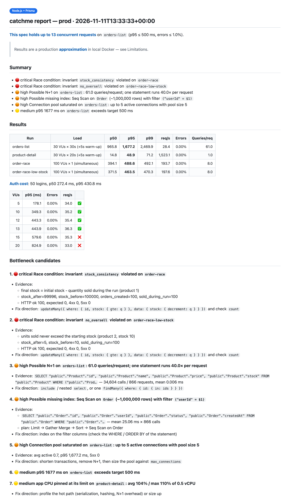
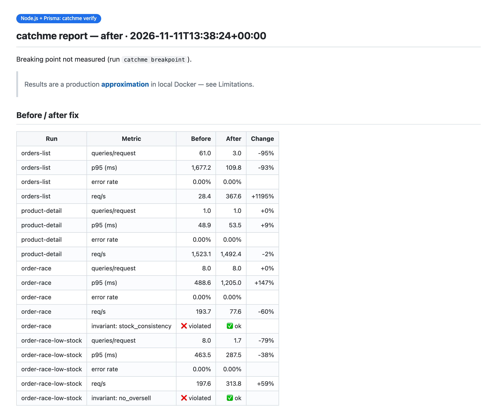

# catchme をはじめる

[English](getting-started.md) · [한국어](getting-started.ko.md) · **日本語** · [简体中文](getting-started.zh-CN.md)

このガイドでは、何もない状態から最初のレポートを得るまでと、その後の修正と再計測までを説明します。初回の実行は
小さなアプリなら全体で **15 分** ほど（大きな実プロジェクトでは、エージェントがより多くのコードを読みシナリオを設計するため、初回は 30〜60 分）かかり、そのほとんどはビルドと負荷テストの待ち時間です。

- [はじめる前に](#はじめる前に)
- [1. インストール](#1-インストール)
- [2. テストを依頼する](#2-テストを依頼する)
- [3. いくつかの質問に答える](#3-いくつかの質問に答える)
- [4. 待っている間に行われること](#4-待っている間に行われること)
- [5. レポートを読む](#5-レポートを読む)
- [6. 修正と再計測](#6-修正と再計測)
- [7. クリーンアップ](#7-クリーンアップ)
- [その他の依頼例](#その他の依頼例)
- [エージェントなしで使う](#エージェントなしで使う)
- [トラブルシューティング](#トラブルシューティング)
- [FAQ](#faq)

## はじめる前に

| 必要なもの | 理由 | 確認方法 |
|---|---|---|
| Compose v2 付きの **Docker** が起動していること | すべてローカルのコンテナで動作するため | `docker compose version` |
| Docker 用に ~**4 GB** の空き | 本番相当の制限をかけたアプリ + Postgres + 負荷生成ツールを動かすため | Docker Desktop → Settings → Resources |
| **Claude Code**（または他のコーディングエージェント） | エージェントが catchme を操作し、結果を読み解くため | `claude --version` |
| **Dockerfile でビルドでき**、**HTTP** で応答するアプリ | catchme は本番と同じ方法でアプリを動かすため | — |
| データベースが **PostgreSQL** であること | catchme は Postgres の統計情報を読んでクエリの問題を見つけるため | — |

アプリの言語は問いません。catchme には Spring、Node（Prisma、TypeORM）、Django、FastAPI 向けのショートカットがあり、
それ以外のものには汎用の手順が用意されています。Go + Redis のデモは汎用の手順を使っています。

Python 3 と curl があればそれを使い、なければ catchme がスクリプトをコンテナ内で実行します。

## 1. インストール

Claude Code で:

```bash
/plugin install catchme --marketplace kmsdevdata-sketch/catchme
```

> ローカルにクローンしたものを試す場合は、`claude --plugin-dir /path/to/catchme` で Claude Code を起動してください。

## 2. テストを依頼する

**プロジェクトのフォルダで** Claude Code を開き、やりたいことを自分の言葉で伝えます:

```text
本番スペックでテストして
```

これだけで十分です。具体的に伝えることもでき、伝える内容が多いほど聞き返される質問は少なくなります:

```text
注文一覧 API を ECS 0.5 vCPU / 1 GB、RDS t3.micro、注文 100 万件でテストして。
あわせて、100 件の同時注文で在庫数が壊れないかも確認して。
```

スキルは自動で読み込まれます（`Skill(catchme:catchme)` と表示されます）。`/catchme:catchme` で明示的に
開始することもできます。

## 3. いくつかの質問に答える

リポジトリに Terraform、CDK、ECS タスク定義、Kubernetes マニフェストがあれば、catchme はそこからサイズを読み取り、
確認だけを求めます。ない場合は、エージェントが次のように質問します:

```text
このリポジトリには IaC が見つかりませんでした。どの本番スペックを再現しますか？
  1. Fargate 0.5 vCPU / 1 GB + RDS t3.micro (推奨)
  2. ...
```

いずれかを選ぶか、自分の構成を伝えてください（「2 vCPU、4 GB、db.t4g.medium」など）。データ量が分からなければ、そう伝えれば大丈夫です。
エージェントが妥当な値を選び、すべての前提をレポートの冒頭に列挙します。

Claude Code の権限確認が表示されることもあります。たとえば、プロジェクト外にある catchme のリファレンスファイルを読む場合です。
許可しても問題ありません。catchme が読むのは自身のファイルだけで、実行するのはローカルのコンテナだけです。

## 4. 待っている間に行われること

| ステップ | catchme が行うこと | 目安の時間 |
|---|---|---|
| 分析 | スタック、ポート、エンドポイント、ログイン、Dockerfile を特定 | 数秒 |
| プロファイル | 本番のサイズを記した `.prod-parity/profile.yaml` を作成 | 数秒 |
| 環境 | アプリをビルドし、CPU/メモリ制限付きで起動。Postgres を RDS クラス相当にチューニングし、DB ラウンドトリップごとに +1 ms を付加 | 1〜3 分（初回ビルド） |
| シード | マイグレーション済みのスキーマに、整合性のとれた数百万行のデータとテストユーザーを投入 | 20〜60 秒 |
| 負荷 | 実際のログイン API でテストユーザーをログインさせ、ウォームアップ、定常負荷、100 件同時のレースを実行 | 2〜3 分 |
| レポート | クエリ統計、実行計画、ロック、CPU/メモリを収集し、レポートを作成 | 数秒 |

すべてプロジェクト内の `.prod-parity/` に出力されます。Docker の外には一切手を加えません。

## 5. レポートを読む

エージェントがチャットで短い要約を返し、`.prod-parity/reports/latest.md` の場所を示します。



- **1 行目** — 結論です。例: *「このスペックで耐えられるのは同時 13 リクエストまで」*（限界点の探索を実行した場合）。
- **Summary** — 重大度別の検出結果です。🔴 critical（データが壊れる。例: レース）、🟠 high（負荷時に問題になる。
  例: N+1、インデックス漏れ）、🟡 medium（知っておくべきこと。例: CPU が上限に達している）。
- **Results** — シナリオごとの p50/p95/p99、秒間リクエスト数、エラー率、**リクエストあたりのクエリ数**。
- **Bottleneck candidates** — それぞれに証拠（SQL、呼び出し回数、EXPLAIN の実行計画、不変条件の行）と、
  スタックに合わせた修正の方向性が付きます。
- **Analysis** — エージェントによる解釈で、コードの file:line と紐づいています。
- **Limitations** — 近似では分からないこと。

レースの検出は **不変条件** に基づきます。これはエージェントが書く小さな SQL チェックで、たとえば *「最終在庫 = 開始時の
在庫 − 実行中に売れた数」* のようなものです。HTTP ステータスコードではレースは分かりません。私たちのデモでは、在庫数が
ずれていてもすべてのリクエストが 201 を返していました。

## 6. 修正と再計測

エージェントは問題を見つけると、コードを変更する前に確認を求めます:

```text
1〜3 を別ブランチで修正して、同じテストを再実行しますか？
```

「はい」と答えてください。エージェントは **新しいブランチで git worktree** を作成し（現在のブランチには一切触れません）、
そこでコードを修正して `verify` を実行します。本番プロファイル、シードデータ、シナリオはすべて同じです。
修正前後の比較表が得られます:



他のブランチと同様にレビューし、問題なければマージしてください。

## 7. クリーンアップ

エージェントにクリーンアップを頼むか、自分で `teardown` を実行します。コンテナ、ボリューム、ビルドしたイメージは
削除されますが、`.prod-parity/` 内のレポートと入力ファイルは残るため、次回はより速く起動し、
前回の結果と比較できます。

## その他の依頼例

| 依頼 | 行われること |
|---|---|
| 「このスペックで同時接続ユーザーは何人まで耐えられる？」 | 目標の p95 / エラー率に対して限界点を探索 |
| 「t3.micro と t3.small を比較して」 | 2 つのプロファイルで同じシナリオを実行 |
| 「自分のノート PC とどれくらい違う？」 | 制限も遅延もないローカルのベースラインを実行し、並べて比較 |
| 「t3.micro の CPU クレジットが尽きたらどうなる？」 | DB をベースラインの CPU 割り当てに制限 |
| 「リグレッションチェックを有効にして」 | エージェントが repository/model ファイルを編集した後、~20 秒のチェックでリクエストあたりのクエリ数が増えたら警告 |
| 「決済 API を 200 件の同時リクエストでテストして」 | カスタムのレースシナリオと、それに対応する不変条件 |
| 「レポートを韓国語で書いて」 | 韓国語のレポート（`en` と `ko` が組み込み。分析はどの言語でも可能） |

## エージェントなしで使う

エンジンは普通の CLI です。プロジェクトのルートで:

```bash
CM=/path/to/catchme/skills/catchme/scripts/catchme
$CM init                         # writes .prod-parity/project.json
$CM profile --app-preset ecs-fargate:0.5vcpu-1gb --db-preset rds:db.t3.micro
# write .prod-parity/seed.yaml, plan.yaml, invariants.yaml (examples: skills/catchme/templates/config/)
$CM all                          # gen → up → seed → load → report
$CM teardown
```

`$CM help` ですべてのコマンドを一覧できます。[`examples/`](../examples) のデモには、すぐに使える入力ファイルが同梱されています。

## トラブルシューティング

| 症状 | 対処法 |
|---|---|
| `Docker daemon is not running` | Docker Desktop を起動し（または `systemctl start docker`）、もう一度依頼してください |
| アプリが起動しない | エージェントが `catchme logs app` を確認します。多くは環境変数の不足で、`.prod-parity/project.json → app.env` に設定します（テスト用の値のみ） |
| `auth step produced no tokens` | ログインに失敗しています。`seed.yaml` のテスト用パスワードハッシュがアプリのハッシュ方式と合っていないか、`plan.yaml` のログインパス / トークンフィールドが間違っています |
| `base_url uses port X but project.json app.port is Y` | どちらかを修正してください。`base_url` は `http://app:<container port>` である必要があります |
| ローカル以外のホストを理由に拒否される | `.env` やアプリ設定が実際のサーバーを指しています。安全チェックが正しく働いている状態です。ローカルの値を使うか、`.env` を `.dockerignore` に追加してください |
| アプリが Redis / Kafka / 外部 API も必要とする | エージェントが `.prod-parity/compose.override.yml` に追加します。`init` は検出すると警告します |
| 実行ごとに数値が大きく変わる | 小さな差はノイズです。特に 0.5 vCPU の JVM で顕著です。計測中は他の重いビルドや処理を実行しないでください |
| Docker の CPU/メモリがプロファイルより少ない | `up` が警告します。Docker にリソースを追加しないと、結果が本番より悪く見えます |
| データベースが MySQL | まだ対応していません。catchme は PostgreSQL の統計情報に依存しています |

## FAQ

**本番システムに触れますか？** いいえ。ローカル Docker の外には一切接続せず、設定が実際のホストを指していれば起動を拒否し、
AWS はあなたが同意した読み取り専用の呼び出しでのみ参照します。

**コードを変更しますか？** 別の worktree の新しいブランチ上でのみ、かつあなたが同意した後にのみ変更します。

**どのくらい正確ですか？** あくまで近似です。CPU 制限、DB クラス、遅延、データ量は再現しますが、CPU の世代、ディスク IOPS、
バーストクレジットの枯渇、実データの分布は再現しません。すべてのレポートに制限事項が記載されます。

**`.prod-parity/` はコミットしてもいいですか？** 入力ファイル（`profile.yaml`、`seed.yaml`、`plan.yaml`、
`invariants.yaml`、`compose.override.yml`）をコミットすれば、他のメンバーも同じテストを実行できます。生成ファイルには
専用の `.gitignore` があります。

**Claude Code 以外のエージェントでも使えますか？** はい。[AGENTS.md](../AGENTS.md) と同じスキルファイルに従って
動作します。
