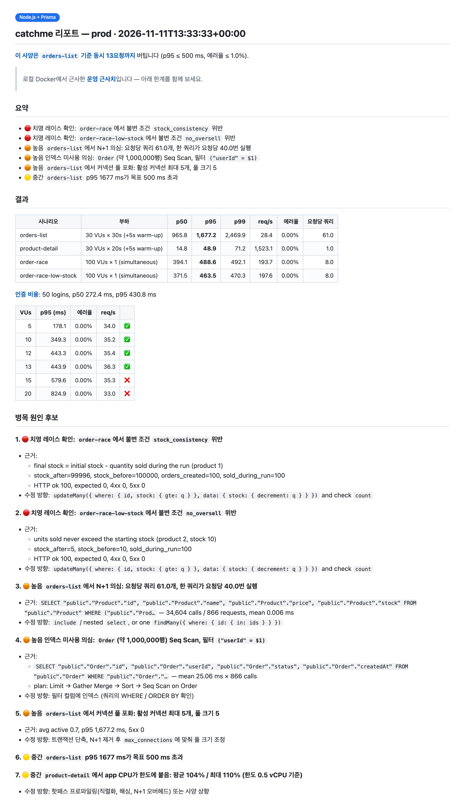
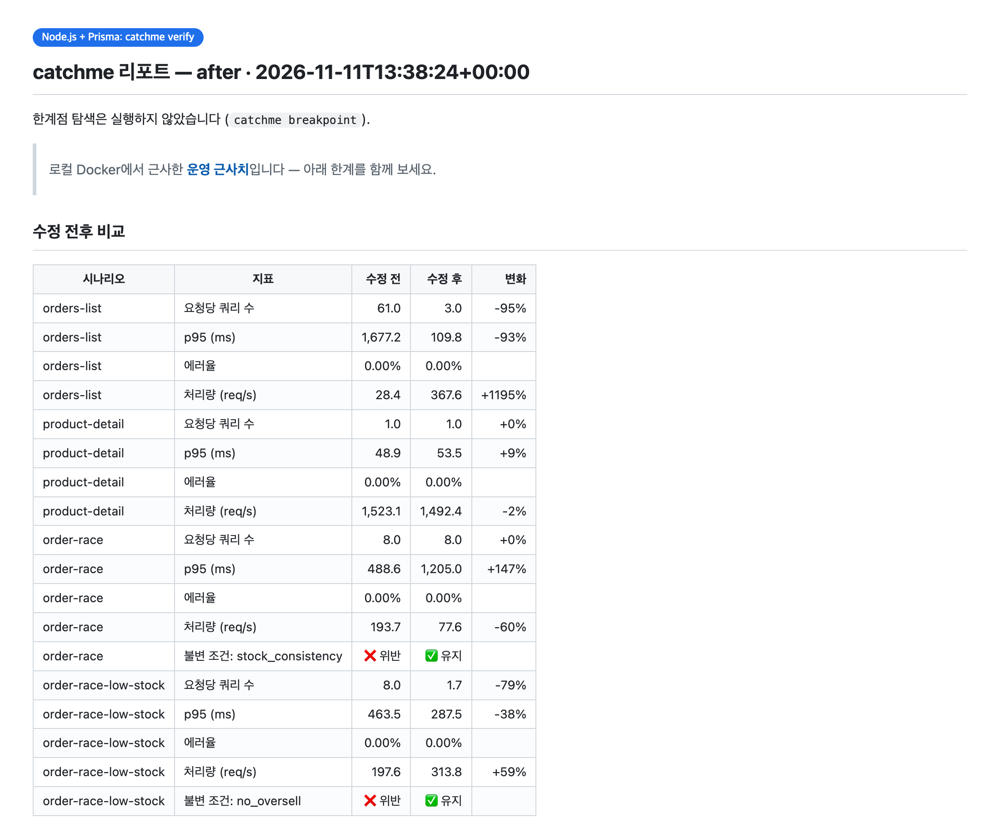

# catchme 시작 가이드

[English](getting-started.md) · **한국어** · [日本語](getting-started.ja.md) · [简体中文](getting-started.zh-CN.md)

설치부터 첫 리포트, 수정과 재측정까지 순서대로 안내합니다. 작은 앱은 처음 끝까지 해보면 **15분쯤** 걸리고(큰 실제 프로젝트는 에이전트가 코드를 더 읽고 시나리오를 더 설계해서 처음엔 30~60분), 대부분은 빌드와
부하 테스트를 기다리는 시간입니다.

- [시작하기 전에](#시작하기-전에)
- [1. 설치](#1-설치)
- [2. 테스트 요청하기](#2-테스트-요청하기)
- [3. 질문 한두 개에 답하기](#3-질문-한두-개에-답하기)
- [4. 기다리는 동안 일어나는 일](#4-기다리는-동안-일어나는-일)
- [5. 리포트 읽기](#5-리포트-읽기)
- [6. 고치고 다시 재기](#6-고치고-다시-재기)
- [7. 정리하기](#7-정리하기)
- [이런 것도 요청할 수 있어요](#이런-것도-요청할-수-있어요)
- [에이전트 없이 쓰기](#에이전트-없이-쓰기)
- [문제 해결](#문제-해결)
- [자주 묻는 질문](#자주-묻는-질문)

## 시작하기 전에

| 필요한 것 | 이유 | 확인 방법 |
|---|---|---|
| 실행 중인 **Docker** (Compose v2) | 모든 것이 로컬 컨테이너에서 돌아갑니다 | `docker compose version` |
| Docker에 여유 메모리 **4GB** 정도 | 앱, Postgres, 부하 생성기를 운영 크기 제한으로 띄웁니다 | Docker Desktop → Settings → Resources |
| **Claude Code** (또는 다른 코딩 에이전트) | 에이전트가 catchme를 실행하고 결과를 해석합니다 | `claude --version` |
| **Dockerfile로 빌드**되고 **HTTP**로 응답하는 앱 | 운영처럼 앱을 띄워서 잽니다 | — |
| DB가 **PostgreSQL** | PostgreSQL 통계를 읽어 쿼리 문제를 찾습니다 | — |

앱은 어떤 언어로 짜여 있어도 됩니다. Spring, Node(Prisma, TypeORM), Django, FastAPI는 자동 감지가 더 잘 되고, 그
밖의 스택은 범용 경로로 처리합니다. Go + Redis 데모가 범용 경로로 동작한 예입니다.

Python 3와 curl이 있으면 쓰고, 없으면 스크립트를 컨테이너에서 실행합니다.

## 1. 설치

Claude Code에서:

```bash
/plugin marketplace add kmsdevdata-sketch/catchme
/plugin install catchme@catchme
```

> 로컬에 클론한 걸로 써보려면 `claude --plugin-dir /path/to/catchme`로 Claude Code를 실행하세요.

## 2. 테스트 요청하기

**프로젝트 폴더에서** Claude Code를 열고 원하는 걸 편하게 말하세요:

```text
운영 사양으로 테스트해줘
```

이것만으로 충분합니다. 구체적으로 말할수록 질문이 줄어듭니다:

```text
ECS 0.5 vCPU / 1GB, RDS t3.micro, 주문 100만 건 기준으로 주문 목록 API를 테스트해줘.
동시 주문 100건에 재고가 틀어지는지도 봐줘.
```

스킬은 자동으로 로드됩니다(`Skill(catchme:catchme)`가 보입니다). 직접 시작하려면 `/catchme:catchme`를 입력하세요.

## 3. 질문 한두 개에 답하기

레포에 Terraform, CDK, ECS task definition, Kubernetes 매니페스트가 있으면 거기서 사양을 읽고 맞는지 확인만 합니다.
없으면 에이전트가 이렇게 물어봅니다:

```text
레포에 IaC가 없어 운영 사양을 자동으로 못 찾았습니다. 어떤 사양으로 테스트할까요?
  1. Fargate 0.5vCPU/1GB + RDS t3.micro (Recommended)
  2. ...
```

하나를 고르거나 직접 설명하세요("2 vCPU, 4GB, db.t4g.medium"). 데이터 규모를 모르면 모른다고 하면 됩니다.
에이전트가 그럴듯한 값을 정하고, 가정한 내용을 모두 리포트 맨 위에 적어둡니다.

Claude Code의 권한 확인 창이 뜰 수도 있습니다. 예를 들어 프로젝트 밖에 있는 catchme 레퍼런스 파일을 읽을 때입니다.
허용해도 안전합니다. catchme는 자기 파일만 읽고, 로컬 컨테이너만 실행합니다.

## 4. 기다리는 동안 일어나는 일

| 단계 | catchme가 하는 일 | 보통 걸리는 시간 |
|---|---|---|
| 분석 | 스택, 포트, 엔드포인트, 로그인 방식, Dockerfile 파악 | 몇 초 |
| 프로필 | 운영 사양을 `.prod-parity/profile.yaml`에 기록 | 몇 초 |
| 환경 구성 | 앱을 빌드하고 CPU·메모리 제한을 걸어 띄움. Postgres는 RDS 클래스처럼 설정하고, DB 왕복마다 +1ms 지연 | 1~3분 (첫 빌드) |
| 시딩 | 마이그레이션된 스키마에 관계가 맞는 데이터 수백만 건과 테스트 계정 생성 | 20~60초 |
| 부하 | 실제 로그인 API로 테스트 계정 로그인 → 예열 → 지속 부하, 동시 요청 100건 | 2~3분 |
| 리포트 | 쿼리 통계, 실행 계획, 락, CPU·메모리를 모아 리포트 작성 | 몇 초 |

모든 파일은 프로젝트의 `.prod-parity/`에 생깁니다. Docker 밖의 것은 건드리지 않습니다.

## 5. 리포트 읽기

에이전트가 채팅에 짧은 요약을 남기고 `.prod-parity/reports/latest.md`를 알려줍니다.



- **첫 줄**: 판정입니다. 예: *"이 사양은 동시 13요청까지 버팁니다"* (한계점 탐색을 실행했을 때).
- **요약**: 심각도별 발견 사항입니다. 🔴 치명(데이터가 틀어짐, 예: 레이스), 🟠 높음(부하가 걸리면 문제가 됨, 예:
  N+1, 인덱스 누락), 🟡 중간(알아둘 것, 예: CPU가 한도에 붙음).
- **결과**: 시나리오마다 p50/p95/p99, 초당 요청 수, 에러율, **요청당 쿼리 수**.
- **병목 원인 후보**: 항목마다 근거(SQL, 호출 횟수, EXPLAIN 계획, 불변 조건 결과)와 스택에 맞는 수정 방향.
- **분석**: 에이전트의 해석입니다. 코드의 file:line과 연결돼 있습니다.
- **한계**: 근사치로는 알 수 없는 것들.

레이스 판정은 **불변 조건**으로 합니다. 에이전트가 작성하는 짧은 SQL 검사입니다. 예: *"최종 재고 = 시작 재고 − 테스트
중 판매된 수량"*. HTTP 상태 코드로는 레이스가 보이지 않습니다. 데모에서는 재고가 틀어지는 동안에도 모든 요청이 201을
돌려줬습니다.

## 6. 고치고 다시 재기

문제를 찾으면 에이전트는 코드를 고치기 전에 먼저 물어봅니다:

```text
1~3번을 별도 브랜치에서 고치고 같은 테스트를 다시 돌려볼까요?
```

*응*이라고 답하세요. 에이전트가 **새 브랜치로 git worktree를 만들어** 거기서 고칩니다. 지금 브랜치는 건드리지 않습니다.
그다음 `verify`로 같은 운영 프로필, 같은 데이터, 같은 시나리오로 다시 잽니다. 결과는 수정 전후 비교표로 나옵니다:



다른 브랜치처럼 리뷰하고, 괜찮으면 머지하세요.

## 7. 정리하기

에이전트에게 정리해달라고 하거나 `teardown`을 직접 실행하세요. 컨테이너, 볼륨, 빌드한 이미지가 지워집니다. 리포트와
`.prod-parity/`의 입력 파일은 남으니, 다음 실행이 더 빠르고 지난번과 비교할 수 있습니다.

## 이런 것도 요청할 수 있어요

| 요청 | 하는 일 |
|---|---|
| "이 사양이면 동시 사용자 몇 명까지 버텨?" | 목표 p95·에러율 기준 한계점 탐색 |
| "t3.micro랑 t3.small 비교해줘" | 같은 시나리오를 두 프로필로 실행 |
| "내 노트북이랑 얼마나 달라?" | 제한·지연 없는 로컬 기준선을 함께 재서 나란히 비교 |
| "t3.micro CPU 크레딧이 바닥나면?" | DB를 기준 CPU 비율로 제한해서 측정 |
| "회귀 체크 켜줘" | 에이전트가 Repository·모델 파일을 고친 뒤 20초 정도의 점검으로 요청당 쿼리가 늘었는지 경고 |
| "결제 API에 동시 200요청 넣어봐" | 그 API용 레이스 시나리오와 불변 조건을 만들어 실행 |
| "리포트는 한국어로" | 리포트를 한국어로 작성 (`en`, `ko` 내장. 분석은 어떤 언어로도 가능) |

## 에이전트 없이 쓰기

엔진은 평범한 CLI입니다. 프로젝트 루트에서:

```bash
CM=/path/to/catchme/skills/catchme/scripts/catchme
$CM init                         # .prod-parity/project.json 생성
$CM profile --app-preset ecs-fargate:0.5vcpu-1gb --db-preset rds:db.t3.micro
# .prod-parity/seed.yaml, plan.yaml, invariants.yaml 작성 (예시: skills/catchme/templates/config/)
$CM all                          # gen → up → seed → load → report
$CM teardown
```

`$CM help`로 모든 명령을 볼 수 있습니다. [`examples/`](../examples)의 데모에는 입력 파일이 미리 들어 있습니다.

## 문제 해결

| 증상 | 해결 방법 |
|---|---|
| `Docker daemon is not running` | Docker Desktop을 켜고(또는 `systemctl start docker`) 다시 요청하세요 |
| 앱이 안 뜸 | 에이전트가 `catchme logs app`을 봅니다. 보통 환경변수가 빠진 경우이고, `.prod-parity/project.json → app.env`에 넣습니다(테스트 값만) |
| `auth step produced no tokens` | 로그인 실패입니다. `seed.yaml`의 테스트 비밀번호 해시가 앱의 해시 방식과 다르거나, `plan.yaml`의 로그인 경로·토큰 필드가 틀렸습니다 |
| `base_url uses port X but project.json app.port is Y` | 둘 중 하나를 고치세요. `base_url`은 `http://app:<컨테이너 포트>`여야 합니다 |
| 로컬이 아닌 호스트 때문에 멈춤 | `.env`나 앱 설정이 실제 서버를 가리키는 겁니다. 안전장치가 제대로 동작한 거예요. 로컬 값을 쓰거나 그 `.env`를 `.dockerignore`에 넣으세요 |
| 앱에 Redis / Kafka / 외부 API도 필요함 | 에이전트가 `.prod-parity/compose.override.yml`에 추가합니다. `init`이 사용 흔적을 보면 미리 알려줍니다 |
| 실행할 때마다 수치가 다름 | 작은 차이는 측정 편차입니다. 0.5 vCPU의 JVM은 특히 그렇습니다. 측정 중에는 빌드처럼 무거운 작업을 같이 돌리지 마세요 |
| Docker의 CPU·메모리가 프로필보다 작음 | `up`이 경고합니다. Docker 자원을 늘리지 않으면 결과가 운영보다 나쁘게 나옵니다 |
| DB가 MySQL | 아직 지원하지 않습니다. catchme는 PostgreSQL 통계에 의존합니다 |

## 자주 묻는 질문

**운영 시스템을 건드리나요?** 아니요. 로컬 Docker 밖으로는 연결하지 않고, 설정이 실제 호스트를 가리키면 시작하지
않습니다. AWS는 동의할 때만 읽기 전용으로 조회합니다.

**내 코드를 바꾸나요?** 별도 worktree의 새 브랜치에서만, 그것도 동의한 뒤에만 바꿉니다.

**얼마나 정확한가요?** 근사치입니다. CPU 제한, DB 클래스, 지연, 데이터 규모는 재현하지만 CPU 세대, 디스크 IOPS,
버스트 크레딧 소진, 실제 데이터 분포는 재현하지 않습니다. 리포트마다 한계가 적혀 있습니다.

**`.prod-parity/`를 커밋해도 되나요?** 입력 파일(`profile.yaml`, `seed.yaml`, `plan.yaml`, `invariants.yaml`,
`compose.override.yml`)은 커밋하면 팀원도 같은 테스트를 돌릴 수 있습니다. 생성 파일은 자체 `.gitignore`로 제외됩니다.

**Claude Code 말고 다른 에이전트에서도 되나요?** 됩니다. [AGENTS.md](../AGENTS.md)와 같은 스킬 파일을 따릅니다.
