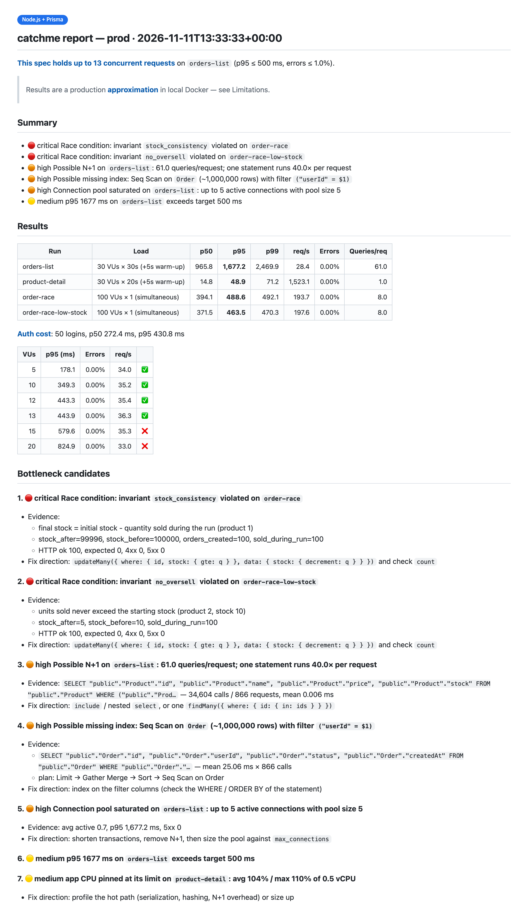
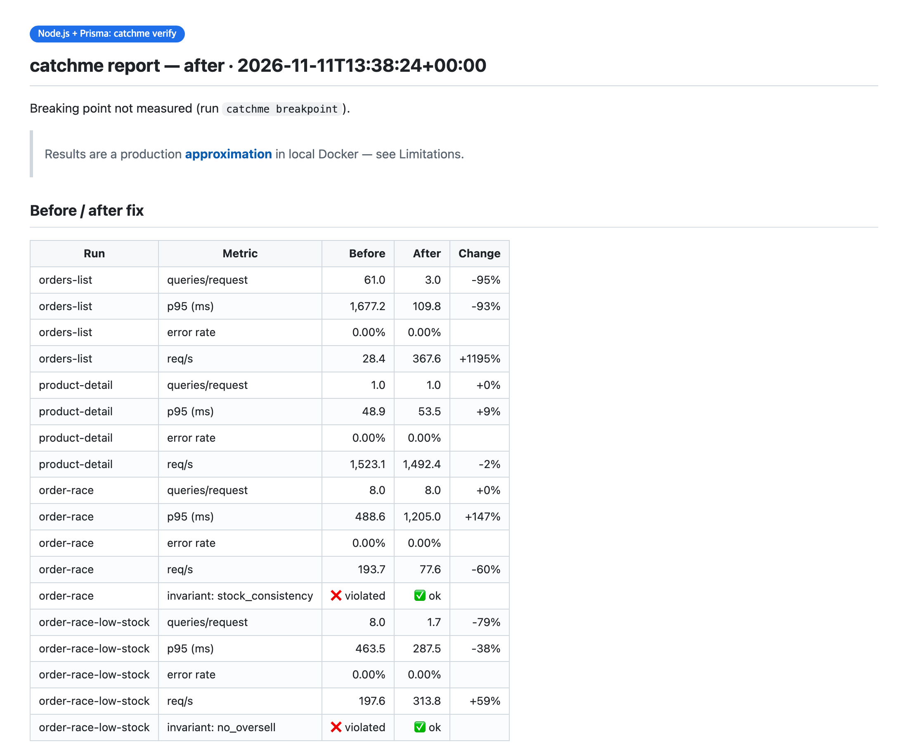

# Getting started with catchme

**English** · [한국어](getting-started.ko.md) · [日本語](getting-started.ja.md) · [简体中文](getting-started.zh-CN.md)

This guide takes you from nothing to your first report, then through a fix and a re-measure. A full first
run takes about **15 minutes** on a small app, most of it waiting while things build and load runs. A large real
project can take 30–60 minutes the first time: the agent reads more code and designs more scenarios.

- [Before you start](#before-you-start)
- [1. Install](#1-install)
- [2. Ask for a test](#2-ask-for-a-test)
- [3. Answer one or two questions](#3-answer-one-or-two-questions)
- [4. What happens while you wait](#4-what-happens-while-you-wait)
- [5. Read the report](#5-read-the-report)
- [6. Fix and re-measure](#6-fix-and-re-measure)
- [7. Clean up](#7-clean-up)
- [More things to ask for](#more-things-to-ask-for)
- [Using it without an agent](#using-it-without-an-agent)
- [Troubleshooting](#troubleshooting)
- [FAQ](#faq)

## Before you start

| You need | Why | Check |
|---|---|---|
| **Docker** with Compose v2, running | everything runs in local containers | `docker compose version` |
| ~**4 GB** free for Docker | app + Postgres + load generator, with production-sized limits | Docker Desktop → Settings → Resources |
| **Claude Code** (or another coding agent) | the agent drives catchme and reads the results | `claude --version` |
| An app that **builds with a Dockerfile** and serves **HTTP** | catchme runs your app the way production does | — |
| **PostgreSQL** as the database | catchme reads Postgres statistics to find query problems | — |

Your app can be written in anything. catchme has shortcuts for Spring, Node (Prisma, TypeORM), Django and
FastAPI, and a generic path for everything else — the Go + Redis demo used the generic path.

Python 3 and curl are used if you have them; if not, catchme runs its scripts in a container.

## 1. Install

In Claude Code:

```bash
/plugin marketplace add kmsdevdata-sketch/catchme
/plugin install catchme@catchme
```

> Trying it from a local clone instead? Start Claude Code with `claude --plugin-dir /path/to/catchme`.

## 2. Ask for a test

Open Claude Code **in your project's folder** and say what you want in your own words:

```text
test this with production specs
```

That's enough. You can also be specific — the more you say, the fewer questions you get:

```text
Test the order list API with ECS 0.5 vCPU / 1 GB, RDS t3.micro and 1M orders.
Also check whether 100 simultaneous orders break the stock count.
```

The skill loads automatically (you'll see `Skill(catchme:catchme)`). You can also start it explicitly
with `/catchme:catchme`.

## 3. Answer one or two questions

If your repo has Terraform, CDK, ECS task definitions or Kubernetes manifests, catchme reads the sizes
from there and only asks you to confirm. Otherwise the agent asks something like:

```text
I couldn't find IaC in this repo. Which production specs should I copy?
  1. Fargate 0.5 vCPU / 1 GB + RDS t3.micro (Recommended)
  2. ...
```

Pick one, or describe yours ("2 vCPU, 4 GB, db.t4g.medium"). If you don't know the data volume, say so —
the agent picks plausible numbers and lists every assumption at the top of the report.

You may also see Claude Code's permission prompts, for example to read catchme's reference files outside
your project. Allowing them is safe; catchme only reads its own files and only runs local containers.

## 4. What happens while you wait

| Step | What catchme does | Typical time |
|---|---|---|
| Analyze | finds your stack, port, endpoints, login, Dockerfile | seconds |
| Profile | writes `.prod-parity/profile.yaml` with the production sizes | seconds |
| Environment | builds your app, starts it with CPU/memory limits, Postgres tuned like the RDS class, +1 ms on every DB round trip | 1–3 min (first build) |
| Seed | fills your migrated schema with millions of consistent rows and test users | 20–60 s |
| Load | logs in test users through your real login API, warms up, runs steady load and 100-at-once races | 2–3 min |
| Report | collects query stats, plans, locks, CPU/memory, and writes the report | seconds |

Everything goes into `.prod-parity/` in your project. Nothing outside Docker is touched.

## 5. Read the report

The agent gives you a short summary in chat and points to `.prod-parity/reports/latest.md`.



- **First line** — the verdict, e.g. *"This spec holds up to 13 concurrent requests"* (when the breaking-point
  search ran).
- **Summary** — findings by severity: 🔴 critical (wrong data, e.g. a race), 🟠 high (will hurt under load,
  e.g. N+1, missing index), 🟡 medium (worth knowing, e.g. CPU at its limit).
- **Results** — p50/p95/p99, requests per second, error rate and **queries per request** for every scenario.
- **Bottleneck candidates** — each with its evidence (the SQL, call counts, the EXPLAIN plan, the invariant
  row) and a fix direction for your stack.
- **Analysis** — the agent's interpretation, tied to file:line in your code.
- **Limitations** — what the approximation can't tell you.

Race findings come from **invariants**: small SQL checks the agent writes, like *"final stock = starting
stock − units sold during the run"*. HTTP status codes can't show a race — every request returned 201 in
our demos while the stock count was wrong.

## 6. Fix and re-measure

When the agent finds something, it asks before changing code:

```text
Should I fix 1–3 on a separate branch and re-run the same tests?
```

Say yes. The agent creates a **git worktree on a new branch** (your current branch is never touched),
fixes the code there, and runs `verify`: same production profile, same seeded data, same scenarios. You
get a before/after table:



Review the branch like any other and merge it if you agree.

## 7. Clean up

Ask the agent to clean up, or run `teardown` yourself. Containers, volumes and the built image are
removed; your reports and the input files in `.prod-parity/` stay, so the next run starts faster and
compares against the last one.

## More things to ask for

| Ask | What happens |
|---|---|
| "How many concurrent users can this spec handle?" | breaking-point search on your target p95 / error rate |
| "Compare t3.micro and t3.small" | the same scenarios under two profiles |
| "How different is it from my laptop?" | a local baseline run with no limits and no latency, side by side |
| "What if the t3.micro runs out of CPU credits?" | the DB limited to its baseline CPU share |
| "Turn on the regression check" | after the agent edits repository/model files, a ~20 s check warns if queries per request went up |
| "Test the checkout API with 200 simultaneous requests" | a custom race scenario plus an invariant for it |
| "Write the report in Korean" | the report in Korean (`en` and `ko` are built in; the analysis can be in any language) |

## Using it without an agent

The engine is a plain CLI. From your project's root:

```bash
CM=/path/to/catchme/skills/catchme/scripts/catchme
$CM init                         # writes .prod-parity/project.json
$CM profile --app-preset ecs-fargate:0.5vcpu-1gb --db-preset rds:db.t3.micro
# write .prod-parity/seed.yaml, plan.yaml, invariants.yaml (examples: skills/catchme/templates/config/)
$CM all                          # gen → up → seed → load → report
$CM teardown
```

`$CM help` lists every command. The demos in [`examples/`](../examples) ship with ready-made input files.

## Troubleshooting

| Symptom | What to do |
|---|---|
| `Docker daemon is not running` | start Docker Desktop (or `systemctl start docker`) and ask again |
| The app doesn't come up | the agent reads `catchme logs app`; usually a missing env var — it goes in `.prod-parity/project.json → app.env` (test values only) |
| `auth step produced no tokens` | the login failed: the test password hash in `seed.yaml` doesn't match your app's hashing, or `plan.yaml` points at the wrong login path / token field |
| `base_url uses port X but project.json app.port is Y` | fix one of them; `base_url` must be `http://app:<container port>` |
| It refuses because of a non-local host | an `.env` or app setting points at a real server. That's the safety check working — use a local value, or add the `.env` to `.dockerignore` |
| My app also needs Redis / Kafka / an external API | the agent adds it in `.prod-parity/compose.override.yml`; `init` warns when it sees one |
| Numbers jump between runs | small differences are noise, especially on a JVM at 0.5 vCPU. Don't build or run other heavy things while it measures |
| Docker has less CPU/memory than the profile | `up` warns; give Docker more resources, or results will look worse than production |
| My database is MySQL | not supported yet — catchme relies on PostgreSQL's statistics |

## FAQ

**Does it touch my production systems?** No. It never connects to anything outside local Docker, refuses
to start if your config points at a real host, and reads AWS only with read-only calls you agree to.

**Does it change my code?** Only on a new branch in a separate worktree, and only after you say yes.

**How accurate is it?** It's an approximation. CPU limits, the DB class, latency and data volume are
reproduced; CPU generation, disk IOPS, burst-credit depletion and real data distributions are not. Every
report lists its limitations.

**Can I commit `.prod-parity/`?** Commit the inputs (`profile.yaml`, `seed.yaml`, `plan.yaml`,
`invariants.yaml`, `compose.override.yml`) so others get the same test; the generated files have their
own `.gitignore`.

**Does it work with agents other than Claude Code?** Yes — they follow [AGENTS.md](../AGENTS.md) and the
same skill file.
