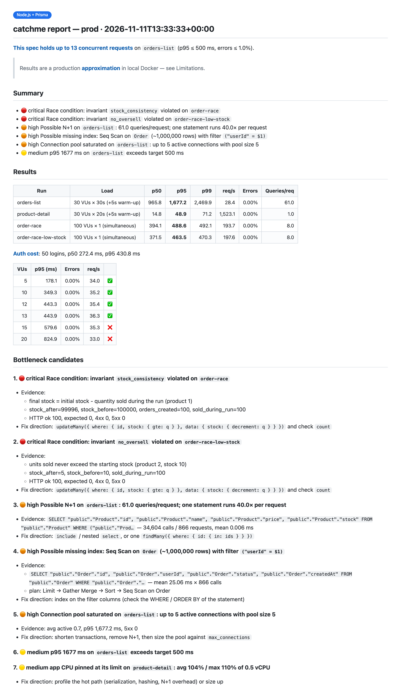
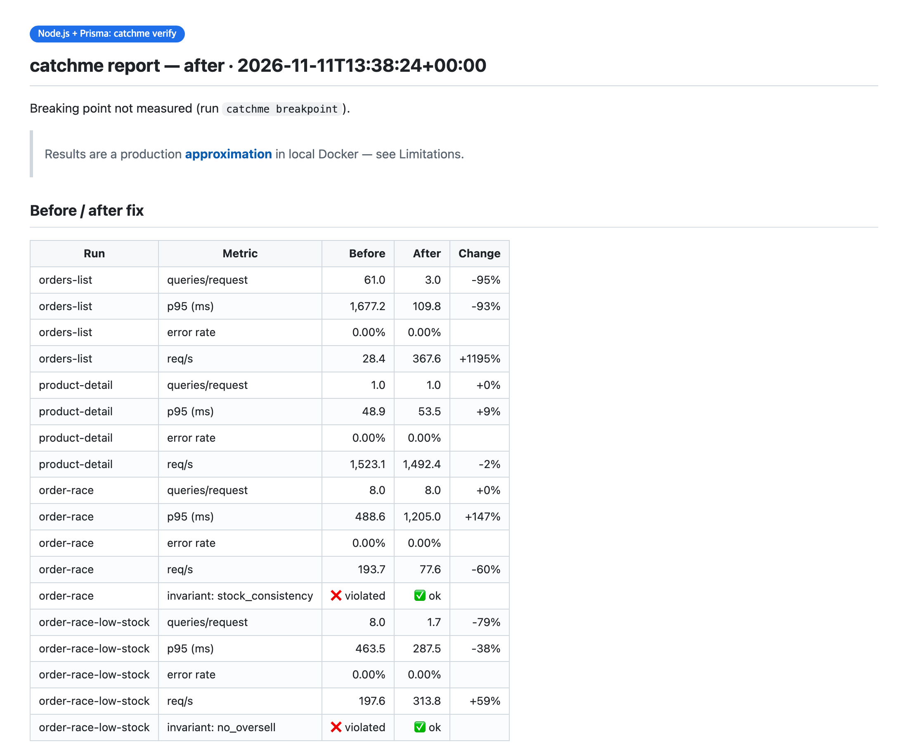

# catchme 入门指南

[English](getting-started.md) · [한국어](getting-started.ko.md) · [日本語](getting-started.ja.md) · **简体中文**

本指南带你从零开始拿到第一份报告，然后完成修复和重新测量。完整的首次运行
大约需要 **15 分钟**，大部分时间都在等待构建和压测。

- [开始之前](#开始之前)
- [1. 安装](#1-安装)
- [2. 发起测试](#2-发起测试)
- [3. 回答一两个问题](#3-回答一两个问题)
- [4. 等待期间发生了什么](#4-等待期间发生了什么)
- [5. 阅读报告](#5-阅读报告)
- [6. 修复并重新测量](#6-修复并重新测量)
- [7. 清理](#7-清理)
- [更多可以提的需求](#更多可以提的需求)
- [不借助 agent 使用](#不借助-agent-使用)
- [故障排查](#故障排查)
- [常见问题](#常见问题)

## 开始之前

| 你需要 | 原因 | 检查方式 |
|---|---|---|
| 已启动的 **Docker**（含 Compose v2） | 所有内容都在本地容器中运行 | `docker compose version` |
| Docker 可用空间约 **4 GB** | 应用 + Postgres + 压测工具，均按生产规格设置限制 | Docker Desktop → Settings → Resources |
| **Claude Code**（或其他编码 agent） | 由 agent 驱动 catchme 并解读结果 | `claude --version` |
| 一个能**用 Dockerfile 构建**并提供 **HTTP** 服务的应用 | catchme 会以生产环境的方式运行你的应用 | — |
| 数据库为 **PostgreSQL** | catchme 通过读取 Postgres 统计信息来定位查询问题 | — |

应用可以用任何语言编写。catchme 为 Spring、Node（Prisma、TypeORM）、Django 和
FastAPI 提供了快捷支持，其他技术栈走通用流程 —— Go + Redis 示例用的就是通用流程。

如果本机有 Python 3 和 curl 就会直接使用；没有的话，catchme 会在容器中运行脚本。

## 1. 安装

在 Claude Code 中执行：

```bash
/plugin install catchme --marketplace kmsdevdata-sketch/catchme
```

> 想从本地克隆的仓库试用？用 `claude --plugin-dir /path/to/catchme` 启动 Claude Code。

## 2. 发起测试

**在项目目录中**打开 Claude Code，用你自己的话说出需求：

```text
按生产环境规格测一下
```

这样就够了。你也可以说得更具体 —— 说得越多，被问的问题就越少：

```text
用 ECS 0.5 vCPU / 1 GB、RDS t3.micro 和 100 万条订单测试订单列表 API。
另外检查一下 100 个并发订单会不会把库存数量搞错。
```

skill 会自动加载（你会看到 `Skill(catchme:catchme)`）。也可以用 `/catchme:catchme`
显式启动。

## 3. 回答一两个问题

如果仓库中有 Terraform、CDK、ECS 任务定义或 Kubernetes 清单，catchme 会从中读取规格，
只需要你确认即可。否则 agent 会问类似这样的问题：

```text
在这个仓库中没有找到 IaC。要复刻哪种生产规格？
  1. Fargate 0.5 vCPU / 1 GB + RDS t3.micro（推荐）
  2. ...
```

选一个，或者描述你自己的规格（"2 vCPU, 4 GB, db.t4g.medium"）。如果不清楚数据量，直接说明即可 ——
agent 会选取合理的数值，并在报告开头列出所有假设。

你还可能看到 Claude Code 的权限提示，例如读取项目之外的 catchme 参考文件。
放心允许即可；catchme 只会读取自己的文件，也只会运行本地容器。

## 4. 等待期间发生了什么

| 步骤 | catchme 做了什么 | 通常耗时 |
|---|---|---|
| 分析 | 识别技术栈、端口、接口、登录方式、Dockerfile | 几秒 |
| 规格 | 将生产规格写入 `.prod-parity/profile.yaml` | 几秒 |
| 环境 | 构建应用，按 CPU/内存限制启动，Postgres 按 RDS 实例类型调优，每次数据库往返 +1 ms | 1–3 分钟（首次构建） |
| 灌数据 | 向已迁移的 schema 灌入数百万行数据一致的记录和测试用户 | 20–60 秒 |
| 压测 | 通过真实的登录 API 登录测试用户，预热后运行稳态负载和 100 并发竞争 | 2–3 分钟 |
| 报告 | 收集查询统计、执行计划、锁、CPU/内存等数据并生成报告 | 几秒 |

所有产物都放在项目的 `.prod-parity/` 目录下。Docker 之外的任何东西都不会被改动。

## 5. 阅读报告

agent 会在对话中给出简短总结，并指向 `.prod-parity/reports/latest.md`。



- **第一行** —— 结论，例如 *"This spec holds up to 13 concurrent requests"*（运行了极限点搜索时）。
- **Summary** —— 按严重程度列出的问题：🔴 critical（数据错误，例如竞态条件）、🟠 high（高负载下会出问题，
  例如 N+1 查询、缺失索引）、🟡 medium（值得关注，例如 CPU 跑满）。
- **Results** —— 每个场景的 p50/p95/p99、每秒请求数、错误率和**每请求查询数**。
- **Bottleneck candidates** —— 每个瓶颈候选都附有证据（SQL、调用次数、EXPLAIN 执行计划、不变量
  检查结果）以及针对你技术栈的修复方向。
- **Analysis** —— agent 的解读，并关联到你代码中的 file:line。
- **Limitations** —— 近似模拟无法说明的部分。

竞态条件的结论来自**不变量**：agent 编写的小型 SQL 检查，例如 *"最终库存 = 初始库存
− 运行期间售出数量"*。HTTP 状态码无法暴露竞态条件 —— 在我们的示例中，所有请求都返回了 201，
而库存数量却是错的。

## 6. 修复并重新测量

agent 发现问题后，会在修改代码前先征求你的同意：

```text
要在独立分支上修复 1–3 并重新运行相同的测试吗？
```

回答"好的"。agent 会**在新分支上创建 git worktree**（绝不改动你当前的分支），
在那里修复代码，然后运行 `verify`：相同的生产规格、相同的种子数据、相同的场景。
你会得到一张修复前后对比表：



像审查其他分支一样审查它，认可的话就合并。

## 7. 清理

让 agent 帮你清理，或者自己运行 `teardown`。容器、数据卷和构建的镜像会被删除；
`.prod-parity/` 中的报告和输入文件会保留，这样下次运行启动更快，并且可以与上次结果对比。

## 更多可以提的需求

| 需求 | 效果 |
|---|---|
| "这个规格能扛住多少并发用户？" | 按目标 p95 / 错误率搜索极限点 |
| "对比一下 t3.micro 和 t3.small" | 在两种规格下运行相同的场景 |
| "和我的笔记本差多少？" | 运行一次无限制、无延迟的本地基线，并排对比 |
| "如果 t3.micro 的 CPU 积分耗尽会怎样？" | 将数据库限制在其基准 CPU 份额 |
| "开启回归检查" | agent 修改 repository/model 文件后，运行约 20 秒的检查，若每请求查询数上升则发出警告 |
| "用 200 个并发请求测试结账 API" | 自定义竞争场景，并附带相应的不变量 |
| "用韩语写报告" | 生成韩语报告（内置 `en` 和 `ko`；分析部分可以用任何语言） |

## 不借助 agent 使用

引擎本身就是一个普通的 CLI。在项目根目录下执行：

```bash
CM=/path/to/catchme/skills/catchme/scripts/catchme
$CM init                         # writes .prod-parity/project.json
$CM profile --app-preset ecs-fargate:0.5vcpu-1gb --db-preset rds:db.t3.micro
# write .prod-parity/seed.yaml, plan.yaml, invariants.yaml (examples: skills/catchme/templates/config/)
$CM all                          # gen → up → seed → load → report
$CM teardown
```

`$CM help` 会列出所有命令。[`examples/`](../examples) 中的示例都附带了现成的输入文件。

## 故障排查

| 现象 | 处理方法 |
|---|---|
| `Docker daemon is not running` | 启动 Docker Desktop（或 `systemctl start docker`）后重新发起请求 |
| 应用启动不起来 | agent 会查看 `catchme logs app`；通常是缺少环境变量 —— 将其写入 `.prod-parity/project.json → app.env`（仅限测试值） |
| `auth step produced no tokens` | 登录失败：`seed.yaml` 中测试密码的哈希与应用的哈希方式不匹配，或 `plan.yaml` 中的登录路径 / token 字段配置错误 |
| `base_url uses port X but project.json app.port is Y` | 修正其中一个；`base_url` 必须是 `http://app:<container port>` |
| 因非本地主机而拒绝执行 | 某个 `.env` 或应用配置指向了真实服务器。这是安全检查在起作用 —— 改用本地值，或将该 `.env` 加入 `.dockerignore` |
| 应用还依赖 Redis / Kafka / 外部 API | agent 会将其添加到 `.prod-parity/compose.override.yml`；`init` 检测到时会给出警告 |
| 多次运行的数据波动较大 | 小幅差异属于噪声，在 0.5 vCPU 的 JVM 上尤其明显。测量期间不要构建或运行其他重负载任务 |
| Docker 分配的 CPU/内存少于规格要求 | `up` 会发出警告；请给 Docker 分配更多资源，否则结果会比生产环境更差 |
| 数据库是 MySQL | 暂不支持 —— catchme 依赖 PostgreSQL 的统计信息 |

## 常见问题

**会碰到我的生产系统吗？** 不会。它绝不会连接本地 Docker 之外的任何东西，配置指向真实主机时会拒绝启动，
读取 AWS 时也只使用经你同意的只读调用。

**会修改我的代码吗？** 只会在独立 worktree 的新分支上修改，并且只在你同意之后。

**准确度如何？** 这是近似模拟。CPU 限制、数据库实例类型、延迟和数据量都会还原；CPU 代际、磁盘 IOPS、
突发积分耗尽和真实数据分布则不会。每份报告都会列出其局限性。

**可以提交 `.prod-parity/` 吗？** 提交输入文件（`profile.yaml`、`seed.yaml`、`plan.yaml`、
`invariants.yaml`、`compose.override.yml`），这样其他人可以运行相同的测试；生成的文件有自己的
`.gitignore`。

**能用于 Claude Code 以外的 agent 吗？** 可以 —— 它们遵循 [AGENTS.md](../AGENTS.md) 和
同一份 skill 文件。
